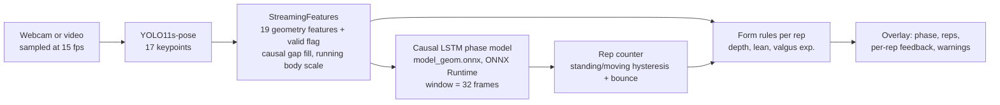

# MotionIQ — squat phase recognition, rep counting and form feedback

MotionIQ watches a person doing squats, detects body keypoints, recognises the movement phase on every frame
(standing / descent / bottom / ascent), counts reps, and flags possible form errors with simple geometric rules: too shallow, forward lean (not reliable;
see limitations) and an experimental, unvalidated knee-valgus check. It runs in real time on a MacBook (Apple Silicon). The only GPU step, training
the phase model, ran once on Google Colab.

> **Status, plainly:** the accuracy numbers come from **recorded video**: the dataset's held-out subjects and three
> external clips, replayed through the same code path as the webcam. Live use was tested in a short scripted session
> with **one person, side view only** (section 7). Squat counting and shallow-depth flags behaved as intended on its 13 squats. The
> forward-lean flag did not, and non-squat movements (knee dips, bending to pick something up) were counted as reps.
> Nothing is validated on other people, views or rooms, and knee valgus is unvalidated.

---

## How it works



- **Pose:** pretrained YOLO11s-pose (CNN). In a crowded gym, the main subject is the box with the largest area × confidence.
- **Geometry features (per frame):**
  - knee and hip angles, trunk lean, hip height, hip-below-knee, knee-over-toe
  - knee/ankle/hip/shoulder widths, the knee-to-ankle width ratio
  - four velocities
  - Distances are divided by a body scale (the median torso length).
  - Short keypoint gaps are interpolated and longer ones held.
  - A per-frame `valid` flag tells the model when the lower body was not actually visible.
- **Phase model:** a unidirectional (causal) 2-layer LSTM over the last 32 frames (2.1 s). It predicts the phase of the newest frame, and normalisation is built into the exported ONNX.
- **Rep counter:** decides only from past frames.
  - Hysteresis applies on the standing ↔ moving boundary.
  - A rep also ends on an ascent → descent "bounce", for continuous reps.
  - A segment counts when it contains descent … ascent in order.
- **Form rules:** pure thresholds on per-rep geometry statistics. Each rule runs only where its fault is visible in 2D:
  - depth and lean: side and diagonal views
  - valgus: front and diagonal views

## Tech stack

YOLO11-pose (Ultralytics), PyTorch, frozen DINOv2-small (Hugging Face `transformers`, self-supervised ViT) and
ResNet-18 (torchvision) for the ablation, ONNX + ONNX Runtime, OpenCV, NumPy. Training ran on Colab with a T4 GPU;
everything else runs on a Mac (MPS/CPU).

## Quick start

```bash
python3.11 -m venv .venv && .venv/bin/pip install -r requirements.txt
```

`yolo11s-pose.pt` downloads automatically on first use. The trained models and configs are in `artifacts/`.

Replay a recorded clip through the full pipeline, using exactly the same code path as the webcam:

```bash
.venv/bin/python scripts/run_demo.py --view side --video path/to/squats.mp4 --record out.mp4
```

Live webcam. `--view` decides which rules run; use `--camera 1` for an external or Continuity camera.

```bash
.venv/bin/python scripts/run_demo.py --view side
```

Camera self-test (10 s each, prints PASS/FAIL checks): once facing an empty scene, once with a person standing
in full view.

```bash
.venv/bin/python scripts/run_demo.py --view front --selftest-camera --expect empty
```

```bash
.venv/bin/python scripts/run_demo.py --view front --selftest-camera --expect person
```

Debug a live session (saves the raw frames and a per-frame log of keypoints, features, phase probabilities,
counter state and stage timings, so the session can be replayed exactly with `--video`):

```bash
.venv/bin/python scripts/run_demo.py --view side --record-raw data/demo/session_raw.mp4 --log-session data/debug/session.npz
```

Tests (rep counter, geometry and rules, streaming parity, empty frames, framing gate; tests that need local data are
skipped on a fresh clone):

```bash
.venv/bin/pip install -r requirements-dev.txt && .venv/bin/python -m pytest -q tests
```

On macOS, if the camera does not open: System Settings → Privacy & Security → Camera → enable the app you launched
from (Terminal, iTerm, VS Code …), then restart that app.

### Reproducing the pipeline

| step | command | output |
|---|---|---|
| labels: auto rep/phase boundaries, split, spot-checks | `scripts/prepare_labels.py` | `data/labels.csv` |
| manual per-rep fault tagging (author) | `scripts/tag_faults.py` | fault columns in `labels.csv` |
| privacy-blur audit | `scripts/blur_audit.py` | `data/blur_audit.csv` |
| pose (YOLO11s-pose, 15 fps) | `scripts/extract_pose.py` | `data/pose/` |
| geometry features | `scripts/extract_features.py` | `data/geom_features/` |
| DINOv2 + ResNet-18 embeddings | `scripts/extract_embeddings.py` | `data/dino_features/`, `data/resnet_features/` |
| training bundle + sanity checks | `scripts/build_training_bundle.py`, `scripts/check_bundle.py` | `artifacts/train_data.npz` (106 MB, not committed) |
| **training (Colab GPU)** | upload `train_data.npz`, run `colab_training.ipynb` (Runtime → T4 GPU → Run all) | `model_geom.onnx`, `model_best.onnx`, `metrics.json` |
| parity test, counter/rule tuning, held-out evaluation | `scripts/evaluate_phase4.py` | `pipeline_config.json`, `form_metrics.json` |
| replay of all held-out clips through the demo | `scripts/run_demo.py --video … --log …`, then `scripts/evaluate_replay.py` | `replay_metrics.json` |

The remaining modules are `config.py` (shared constants such as FPS = 15), `pipeline.py` (the streaming pipeline),
`rep_counter.py` and `form_rules.py`.

## Data

**Primary dataset:** Duddela Sai Prashanth, Priya Kamath, Rakshith Bhandary, S Ashlesh Pai, Pratham PN, Advith P,
Abhishek Mashetty. *A Multi-View Raw Video Dataset of Seven Fitness Exercises with Good/Bad Form Labels.*
Mendeley Data, **v3** (10 Aug 2026). DOI [10.17632/kgbb3yn47p.3](https://doi.org/10.17632/kgbb3yn47p.3).
License: [CC BY 4.0](https://creativecommons.org/licenses/by/4.0/).

What I used and changed:
- **Squat videos only:** from the "exercise quality-wise" folder, 3 views (front, side, diagonal) × good/bad, at 15 fps.
- **25 subjects, not 26:** the dataset page says 26, but the squat portion has no subject_025.
- **10 clips quarantined:** 5 pairs of squat clips were byte-identical (same SHA-256) under different labels or subjects, and both copies of each pair were dropped.
- **4 clips dropped for blur:** in these, the dataset's privacy blur covered the body on ≥30% of frames.
- **Final set:** 136 clips (69 good, 67 bad), 60,123 frames, 1,875 reps.
- **Split, by subject:** 20 subjects for training (16 train + 4 internal validation) and 5 held out (004, 009, 010, 021, 024; 30 clips). The held-out subjects were used only for the reported numbers.
- **Not redistributed:** no dataset videos are in this repository. `data/labels.csv` (committed) contains my annotations on top of the dataset's file names and good/bad labels.

**My annotations:**
- **Phase boundaries:** auto-generated from a pose-based depth signal and spot-checked.
- **Per-rep fault tags:** I added tags (`shallow_depth`, `forward_lean`, `knee_valgus`, plus `other` / `unclear`) by hand on top of the dataset's clip-level good/bad label. A fault is tagged only on views where it is observable, and is marked `n/a` elsewhere.

**External test clips** (Wikimedia Commons; used only for testing; not committed):
- "Kettlebell Racked Squats (side view)" by Taco fleur, CC BY-SA 4.0. [Commons page](https://commons.wikimedia.org/wiki/File:Kettlebell_Racked_Squats_(side_view).webm)
- "Squats Wikipedia" by CRiles23, CC BY-SA 3.0. [Commons page](https://commons.wikimedia.org/wiki/File:Squats_Wikipedia.webm)
- "Muscle Strengthening at Home - Half squat" by the US Centers for Disease Control and Prevention, public domain. [Commons page](https://commons.wikimedia.org/wiki/File:Muscle_Strengthening_at_Home_-_Half_squat.webm)

## Results

All results are on the **5 held-out subjects (30 clips)** unless stated otherwise. Nothing was tuned on them.

### 1. Phase classifier (per frame; claim separate from form rules)

Causal LSTM, W = 32, 3 seeds per feature set. Selection used internal-validation subjects only.

| input features | dim | val macro-F1 | held-out accuracy | held-out macro-F1 |
|---|---|---|---|---|
| **geometry + valid** | 20 | 0.864 ± 0.002 | **0.896 ± 0.002** | **0.891 ± 0.002** |
| ResNet-18 (frozen) | 512 | 0.649 ± 0.019 | 0.753 ± 0.005 | 0.737 ± 0.003 |
| DINOv2-small CLS (frozen) | 384 | 0.732 ± 0.000 | 0.781 ± 0.005 | 0.765 ± 0.005 |
| geometry + ResNet-18 | 532 | 0.778 ± 0.001 | 0.826 ± 0.008 | 0.813 ± 0.009 |
| geometry + DINOv2 | 404 | 0.813 ± 0.006 | 0.837 ± 0.002 | 0.827 ± 0.002 |

Per-phase held-out F1:

| model | standing | descent | bottom | ascent |
|---|---|---|---|---|
| geometry | 0.919 | 0.873 | 0.864 | 0.906 |
| geometry + DINOv2 | 0.886 | 0.797 | 0.797 | 0.828 |

- **Geometry wins,** which is expected because the phase labels were generated from pose (see limitations).
- **The visual-only models learn phases without any pose input:** DINOv2 reaches 0.77 macro-F1 and beats ResNet-18 by about 3 points.
- **Adding embeddings to geometry hurts,** likely overfitting to how subjects and scenes look, with only 16 training subjects.
- **Deployed model:** the geometry-only model (`model_geom.onnx`). Streaming on the Mac it reaches macro-F1 0.889 on held-out clips, vs 0.891 offline.

### 2. Rep counting

The reference reps were **auto-generated** from the pose-based depth signal, so this measures agreement with that
reference, not with an independent human count.

| view | reps counted / reference | clips with exact count | mean abs. error per clip |
|---|---|---|---|
| front | 133 / 135 | 8 / 10 | 0.2 |
| side | 118 / 120 | 9 / 10 | 0.2 |
| diagonal | 130 / 132 | 8 / 10 | 0.2 |
| **all** | **381 / 387** | **25 / 30** (29/30 within ±1) | **0.2** |

All errors are undercounts. The counter was tuned on the internal-validation subjects (MAE 0.24 reps/clip).

### 3. Form rules (per rep; agreement with my own tags)

Rules were tuned on the 20 training-split subjects. These numbers measure **agreement with my own fault tags**,
not an external ground truth. They're computed on reference rep segments; "end-to-end" uses the model's own
rep segmentation, and counts missed reps as false negatives and spurious reps as false positives.

| rule (view) | rule | TP / FP / FN / TN | precision | recall | end-to-end P / R | training-split F1 | held-out F1 |
|---|---|---|---|---|---|---|---|
| shallow depth (side, diagonal) | max hip-below-knee over the rep < threshold | 82 / 18 / 12 / 129 | 0.82 | 0.87 | 0.81 / 0.84 | 0.64 | 0.85 |
| forward lean (side, diagonal) — **provisional** | trunk angle at the bottom > 34° (diagonal) / 45° (side) | 31 / 11 / 6 / 193 | 0.74 | 0.84 | 0.74 / 0.84 | **0.28** | 0.79 |
| knee valgus (front, diagonal) — **experimental, unvalidated** | knee/ankle width ratio at the bottom < 0.60 | 0 positives | – | – | – | not tuned | **false-alarm rate 1/253 = 0.4%** |

- By view (precision / recall): depth is 0.83 / 0.83 side and 0.81 / 0.92 diagonal; lean is 0.83 / 0.83 side and 0.70 / 0.84 diagonal.
- **Forward lean is provisional.**
  - The rule separates the training-split tags poorly (F1 0.28), but scores 0.79 on held-out.
  - The held-out positives come from only 2 subjects (37 reps) whose lean is pronounced.
  - Treat that gap as a warning, not a success.
- **Knee valgus is a fixed literature threshold** and was never tuned.
  - The threshold is the normalised knee-separation cut-off (< ~60% of ankle separation) from the drop-jump screening test: Noyes et al. 2005, *Am J Sports Med* 33(2):197–207.
  - The dataset has 0 tagged valgus reps, so only its false-alarm rate can be measured.

### 4. Latency

| what | time |
|---|---|
| phase model, ONNX Runtime CPU, one 32-frame window (Colab CPU) | 0.47 ms median (p95 0.56) — geometry model; 0.69 ms for geometry + DINOv2 |
| phase model, PyTorch FP32 on a T4 GPU | 0.45 ms |
| **end-to-end per frame on an Apple Silicon Mac (MPS)**: YOLO11s-pose + features + ONNX + counter + rules | **20.55 ms median of per-clip medians; worst-clip p95 26.3 ms** across the 30 held-out replays (budget 66.7 ms at 15 fps); YOLO is ~20 ms of it |
| TensorRT FP16 | attempted on Colab, blocked by an API change (`BuilderFlag.FP16` removed in the TensorRT 10 that pip installed); not retried because the result is reporting-only |

### 5. Robustness checks (no live person)

- **Same code path:** replaying all 30 held-out clips through `run_demo.py` gives frame-for-frame identical phases and reps to the offline evaluation.
- **Streaming vs offline features:** given the offline body scale, the streaming feature code matches the training features exactly (difference 0.0).
  - In deployment the body scale is a running median, because the offline whole-clip median needs future frames.
  - That leaves a small skew: 98.3% frame-level phase agreement, and identical rep counts on 30/30 clips.
- **External videos:**
  - Clean side-view clip: all 6 real squats were counted at the right times, despite strong backlighting and a small subject.
  - Two kettlebell pick-ups were also counted as reps (see limitations).
  - Instructional clips with close-ups and cutaways ran without crashes.
  - One bug found this way was fixed: leg-only close-ups had corrupted the body scale.
- **Live camera self-test** (author's Mac camera, 10 s per scenario; no squats performed):

  | scenario | person box | state / visibility | reps | processed | latency median / p95 | result |
  |---|---|---|---|---|---|---|
  | empty scene (wall, nobody in frame) | 0% of 147 frames | "no person / lower body not visible" on 100% | 0 | 14.6 fps | 20.9 / 28.3 ms | PASS |
  | person standing in full view | 100% of 145 frames (median max confidence 0.92, p10 0.89) | lower body visible on 85% | 0 | 14.5 fps | 23.9 / 32.9 ms | PASS |

  This verifies the live capture path, person detection, lower-body keypoints, empty-scene handling and latency.
  It does **not** validate squat counting or form feedback on a live person.

### 6. First live session: debugging

A first live webcam session (side view, about 87 s, the author squatting) was used **for diagnosis only**. It
showed clear failures. The session was reconstructed from its overlay recording, and every number below comes from
replaying it through the pipeline.

| | before fixes | after fixes |
|---|---|---|
| reps counted in the session (manual reference: ~13 squats + 1 partial bend, then walking toward the camera, empty wall, face close-up) | 22 in replay (25 live) | **14** in replay |
| "reps" counted while walking toward the camera with only the legs in frame | 8 | **0** (rejected: body not fully in frame) |
| held-out regression gate (phase macro-F1, reps, rule counts) | 0.889, 381/387, unchanged | **identical** |
| validation subjects (phase, reps, rules) | — | **identical**, 0 reps rejected |

Root causes and fixes:
- **Reps were counted with the body out of frame** (walking toward the camera). Each completed rep must now have the upper body observed on ≥ 25% of its frames and the lower body on ≥ 25%. Both bounds are below the minimum over all 1,488 training-split reps (0.375 / 0.294), so no training rep is rejected.
- **The camera was low and close**, with the shoulders out of frame on 60% of squat frames. That made the body scale unstable and kept "calibrating" reappearing. There's now an explicit warning, "upper body out of frame".
- **`--view` didn't match the actual stance** (squats facing the camera or turned diagonal while `--view side`). There's now a view check from shoulder width, with a 0.3% mean false-warning rate on training clips.
- **Per-rep verdicts stayed on screen indefinitely.** They now fade 10 s after the last rep.
- **A phantom person was detected on clothes hanging on the wall.** It's contained (no reps counted) but not fixed, since a confidence threshold would also drop real frames.
- **Still open:** extra counts seen live but not in the replay (reaching for the camera, turning between views) need a raw-frame session to diagnose.

Full-loop latency in replay (pose, features, ONNX, rules, drawing, overlay and raw recording): 24.6 ms median,
p95 32.7 ms. During the live session, per-frame time rose from ~24 to ~33–37 ms after 40 s (load or thermal),
which is still within budget.

The extra live counts from that session could not be reproduced afterwards. In the scripted test runs below (raw
frames logged), every extra count was traced to a cause.

### 7. Live test (scripted, one person, side view)

After the fixes, two scripted test runs were recorded and scored from their raw-frame logs. The pipeline was frozen,
and nothing was tuned on them. Replaying the logged keypoints reproduces the live rep segments exactly.
**Scope:** one person, one room, side view only, about 2.3 minutes in total. In run 1 the hands were on the wall for
every squat; in run 2 they reached toward a box at the bottom. The chair-sit block was not done.

| block | intended | counted | flags shown | verdict |
|---|---|---|---|---|
| good squats (runs 1 + 2) | 4 + 1 + 5 = 10 deep squats | **10** | 0 shallow, 0 leaning | as intended |
| shallow squats (run 1) | 3 | **3** | 3/3 "too shallow" (closest miss: 0.095 torso lengths) | as intended |
| leaning squats (run 2) | 5 deep squats, chest forward | 5 | **0/5 "leaning"**: lean at the bottom 27–32° vs 45° threshold; the visible 46–52° lean happens mid-rep | **fails** |
| small knee dips (run 2) | 0 reps | **4** | all "too shallow" | **fails**: dips look like quarter squats |
| pick up an object from the floor (run 2) | 0 reps | **8** (one held forward bend) | all "too shallow" + "leaning" | **fails**: phase flicker during a held bend |
| stand still 20 s (run 2) | 0 reps; feedback fades | 0 | feedback cleared ~9.7 s after the last rep | as intended |
| walk toward the camera (both runs) | 0 reps | **0** | "Not counted: body not fully in frame" | as intended |

- **Latency** (full live loop including display, on this Mac): 15 fps held, 0 dropped frames.
  - Processing p95 53.5 ms against a 66.7 ms budget.
  - Pose takes ~31 ms live vs ~21 ms in replay.
- **Side-on warning:** correct when facing the camera. It also flashes for 0.5–1.5 s after deep reps where the hands reach forward: the 2 s window still holds the rotated shoulders from the bottom of the rep.
- **Calibration** cleared in ~3.3 s when standing still. It is display-only and never blocks counting.

**Next to the recorded-clip numbers** (held-out: `artifacts/form_metrics.json`, `artifacts/replay_metrics.json`,
`artifacts/regression_gate_heldout.json`; validation subjects: `scripts/regression_check.py --role val`; live: local
session logs, which are not published because they contain the author's own recordings):

| | held-out subjects (5) | validation subjects (4) | live test (1 person) |
|---|---|---|---|
| rep counting | 381/387, 25/30 clips exact | 283/284 | 13/13 squats; but 12 non-squat "reps" (4 dips + 8 from one pick-up) |
| shallow depth P / R | 0.82 / 0.87 | 0.48 / 1.00 | 3/3 shallow flagged, 0/10 deep flagged |
| forward lean P / R | 0.74 / 0.84 (2 subjects) | 0.08 / 0.20 | 0/5 intended lean flagged; 0/10 false flags |
| knee valgus | false alarms 1/253 | false alarms 2/178 | not tested (side view) |

## Known limitations

- **Phase labels are auto-generated from pose angles** (a hip-depth signal; the knee angle for two clips), spot-checked but not independently verified. The geometry-only phase model is therefore strong partly by construction, and phase accuracy should be read with that caveat.
- **Fault tags are self-annotated** on top of the dataset's binary good/bad labels, not provided by the dataset authors. Per-rule precision/recall validates consistency with my own labelling, not an external ground truth.
- **Rep-count reference is auto-generated** (pose-derived), not an independent human count.
- **Subject IDs may not map one-to-one to people:** subjects 005/006 and 015/026 shared byte-identical clips, so the subject-wise split could be slightly optimistic.
- **Privacy-blurred training videos vs a real webcam:** the dataset's anonymisation blur sometimes covers the body (2.8% of frames). The DINOv2/ResNet embeddings were extracted from these blurred gym videos and may not transfer to an unblurred webcam. The deployed model uses geometry only, partly for this reason.
- **Live use is tested on one person only** (side view, one room, ~2.3 min of scripted test runs, with hand support at the bottom; section 7). Squat counting and shallow-depth flags behaved as intended there. Nothing is validated on other people, front or diagonal live views, other rooms or cameras.
- **Non-squat movements are counted as reps.** Live: 4 small knee dips → 4 reps; one held forward bend to pick something up → 8 reps. External clip: kettlebell pick-up/put-down hinges. Dips are indistinguishable from quarter-depth squats, which must be counted to be flagged. During a held bend the phase model flickers between descent and ascent, and the counter's bounce rule closes a rep at each flicker. Fixing this needs non-squat training examples or a counter rule validated on the training/validation split.
- **The forward-lean flag is not reliable.** It measures the torso at the bottom of the rep only. Live, 0 of 5 intended leaning squats were flagged: their lean at the bottom was 27–32°, while the visible 46–52° lean is mid-rep. On the validation subjects it reaches only P 0.08 / R 0.20. Measuring lean over the whole rep was evaluated and rejected, because it flags 15.5% (train) / 30.6% (validation) of good reps; large mid-rep lean is normal in good squats.
- **The side-on (view) check can flash for 0.5–1.5 s after deep reps** when the shoulders rotate at the bottom (e.g. hands reaching forward). A standing-only variant was evaluated and rejected: it gave more false warnings on training clips (0.31% → 1.13% of frames).
- **A rejected movement re-shows faded verdicts** together with its "Not counted" message (display only).
- **Rep-counter deviation from the original spec:** a rep needs descent … ascent in order, and does **not** require a separate predicted bottom phase. Requiring it more than doubled the validation count error (0.24 → 0.57 reps per clip), because the model sometimes predicts only 0–2 bottom frames on fast or shallow reps.
- **Forward lean is weak on training subjects** (F1 0.28); its held-out numbers come from 2 subjects. **Knee valgus is unvalidated** (0 positive examples, and not tested live).
- **Body-scale skew:** live features use a causal running-median body scale, while the model was trained on whole-clip medians. The first seconds of a session are less reliable (the overlay says "calibrating"). Retraining on causal-scale features would remove this.
- Small data overall: 25 subjects, one gym-dominated dataset, and three external clips. Exact-hash duplicate checking cannot catch re-encoded near-duplicates.

## Descoped, on purpose

These were designed for but cut to fit a ~36–38 hour budget:
- **SAM2 segmentation:** person masks would help in crowded gyms. The largest-box heuristic was adequate here, and SAM2 would add a second heavy model to the live loop.
- **VideoMAE fine-tuning:** a video transformer on raw clips needs far more GPU time and data than one Colab session and 136 clips. Frozen per-frame embeddings plus a small temporal model answered the same question (do visual features help?) cheaply.
- **VLM weak labeling:** auto-tagging faults with a vision-language model would have scaled the labels, but without a trusted ground truth its errors would have been unmeasurable. I tagged reps by hand instead.

## What I would do next

1. Record or collect a small, consented, **independently labelled live set** (reps, phases and faults, including real valgus) to validate live mode and the valgus rule.
2. Retrain the phase model on **causal running-scale features** to remove the train/live skew, and add **non-squat negatives** (hinges, bends, walking) so the counter can reject them.
3. Replace the pose-derived phase labels with a small set of hand-labelled phase boundaries, so the geometry-vs-visual comparison is fair.
4. Learn the form rules (or a small classifier) from more subjects with a second annotator, and report inter-annotator agreement.
5. Retry the TensorRT FP16 benchmark with the TensorRT 10 API (strongly-typed networks).

## Repository layout

```
motioniq-project/
├── README.md
├── LICENSE                   MIT (code only; dataset licenses above stay with their owners)
├── requirements.txt          (+ requirements-dev.txt: pytest)
├── tests/                    pytest regression tests
├── colab_training.ipynb      the only Colab artifact (training + ONNX export)
├── scripts/                  everything that runs on the Mac (see the table above)
├── artifacts/                model_geom.onnx, model_best.onnx, metrics.json, pipeline_config.json,
│                             form_metrics.json, replay_metrics.json  (train_data.npz not committed)
└── data/labels.csv           per-rep phase boundaries + my fault tags (videos/features not committed)
```

## License

Code: MIT (see `LICENSE`). The Mendeley dataset is CC BY 4.0, and the external clips carry their own licenses
(listed above). None of them is redistributed here.
